<picture><source media="(prefers-color-scheme: light)" srcset="assets/light/header.svg"></picture>

<picture><source media="(prefers-color-scheme: light)" srcset="assets/light/typing.svg"></picture>
 

<picture><source media="(prefers-color-scheme: light)" srcset="assets/light/views-left.svg"></picture><picture><source media="(prefers-color-scheme: light)" srcset="assets/light/views-right.svg"></picture>

<picture><source media="(prefers-color-scheme: light)" srcset="assets/light/divider.svg"></picture>

<!-- ═══════════════ ABOUT ═══════════════ -->
<picture><source media="(prefers-color-scheme: light)" srcset="assets/light/section-01.svg"></picture>

<picture><source media="(prefers-color-scheme: light)" srcset="assets/light/about-bio.svg"></picture>

<table>
<tr>
<td width="58%" valign="top"><picture><source media="(prefers-color-scheme: light)" srcset="assets/light/about-code.svg"></picture></td>
<td width="42%" valign="top"><picture><source media="(prefers-color-scheme: light)" srcset="assets/light/what-i-do.svg"></picture></td>
</tr>
</table>

<picture><source media="(prefers-color-scheme: light)" srcset="assets/light/divider.svg"></picture>

<!-- ═══════════════ SKILLS ═══════════════ -->
<picture><source media="(prefers-color-scheme: light)" srcset="assets/light/section-02.svg"></picture>

<picture><source media="(prefers-color-scheme: light)" srcset="assets/light/skills.svg"></picture>

<picture><source media="(prefers-color-scheme: light)" srcset="assets/light/divider.svg"></picture>

<!-- ═══════════════ EXPERIENCE ═══════════════ -->
<picture><source media="(prefers-color-scheme: light)" srcset="assets/light/section-03.svg"></picture>

<picture><source media="(prefers-color-scheme: light)" srcset="assets/light/experience.svg"></picture>

<picture><source media="(prefers-color-scheme: light)" srcset="assets/light/divider.svg"></picture>

<!-- ═══════════════ PROJECTS ═══════════════ -->
<picture><source media="(prefers-color-scheme: light)" srcset="assets/light/section-04.svg"></picture>

<table>
<tr>
<td width="50%" valign="top"><picture><source media="(prefers-color-scheme: light)" srcset="assets/light/project-01.svg"></picture></td>
<td width="50%" valign="top"><picture><source media="(prefers-color-scheme: light)" srcset="assets/light/project-02.svg"></picture></td>
</tr>
<tr>
<td width="50%" valign="top"><picture><source media="(prefers-color-scheme: light)" srcset="assets/light/project-03.svg"></picture></td>
<td width="50%" valign="top"><picture><source media="(prefers-color-scheme: light)" srcset="assets/light/project-04.svg"></picture></td>
</tr>
</table>

<picture><source media="(prefers-color-scheme: light)" srcset="assets/light/divider.svg"></picture>

<!-- ═══════════════ ACHIEVEMENTS ═══════════════ -->
<picture><source media="(prefers-color-scheme: light)" srcset="assets/light/section-05.svg"></picture>

<table>
<tr>
<td width="50%" valign="top"><picture><source media="(prefers-color-scheme: light)" srcset="assets/light/awards.svg"></picture></td>
<td width="50%" valign="top"><picture><source media="(prefers-color-scheme: light)" srcset="assets/light/certs.svg"></picture></td>
</tr>
</table>

  <picture><source media="(prefers-color-scheme: light)" srcset="https://github-trophies.devomb.com/?username=Arghya-Bose&theme=flat&no-frame=true&no-bg=true&row=1&column=1&margin-w=8"></picture>

<picture><source media="(prefers-color-scheme: light)" srcset="assets/light/divider.svg"></picture>

<!-- ═══════════════ STATS ═══════════════ -->
<picture><source media="(prefers-color-scheme: light)" srcset="assets/light/section-06.svg"></picture>

<picture><source media="(prefers-color-scheme: light)" srcset="https://github-stats-extended.vercel.app/api?username=Arghya-Bose&show_icons=true&hide_border=true&bg_color=F0FDFA&title_color=0F766E&icon_color=0D9488&text_color=334155"></picture>
<picture><source media="(prefers-color-scheme: light)" srcset="assets/light/top-languages.svg"></picture>

<picture><source media="(prefers-color-scheme: light)" srcset="https://github-readme-streak-stats.herokuapp.com/?user=Arghya-Bose&hide_border=true&background=F0FDFA&ring=0D9488&fire=0F766E&currStreakLabel=0F766E&currStreakNum=0F172A&sideNums=0F172A&sideLabels=115E59&dates=475569"></picture>

<picture><source media="(prefers-color-scheme: light)" srcset="https://github-readme-activity-graph.vercel.app/graph?username=Arghya-Bose&hide_border=true&bg_color=F0FDFA&color=0F766E&line=0D9488&point=0F172A&area=true&area_color=0D9488"></picture>

<picture><source media="(prefers-color-scheme: light)" srcset="assets/light/divider.svg"></picture>

<!-- ═══════════════ CONTACT ═══════════════ -->
<picture><source media="(prefers-color-scheme: light)" srcset="assets/light/section-07.svg"></picture>

<a href="https://github.com/Arghya-Bose"><picture><source media="(prefers-color-scheme: light)" srcset="assets/light/btn-github.svg"></picture></a>
<a href="https://www.linkedin.com/in/arghya--bose/"><picture><source media="(prefers-color-scheme: light)" srcset="assets/light/btn-linkedin.svg"></picture></a>
<a href="mailto:bosearghya83@gmail.com"><picture><source media="(prefers-color-scheme: light)" srcset="assets/light/btn-email.svg"></picture></a>
<a href="https://github.com/Arghya-Bose?tab=repositories"><picture><source media="(prefers-color-scheme: light)" srcset="assets/light/btn-repos.svg"></picture></a>

 

<picture><source media="(prefers-color-scheme: light)" srcset="assets/light/hero-info.svg"></picture> 

<picture><source media="(prefers-color-scheme: light)" srcset="assets/light/footer.svg"></picture>
