<!-- ═══════════════ HEADER ═══════════════ -->
<div align="center">



<a href="https://github.com/Arghya-Bose">
  
</a>

<br/>


<br/><br/>

<a href="https://www.linkedin.com/in/arghya--bose/"></a>
<a href="mailto:bosearghya83@gmail.com"></a>
<a href="https://github.com/Arghya-Bose?tab=repositories"></a>

</div>


<!-- ═══════════════ ABOUT ═══════════════ -->


<table>
<tr>
<td width="58%" valign="top">

I'm a **Computer Science & Engineering graduate** and a **Mobile App Developer at Bdjobs.com Ltd.**, passionate about building reliable, scalable and user-friendly software that real people use every day.

```kotlin
class Arghya : Developer {

    val role      = "Mobile App Developer"
    val company   = "Bdjobs.com Ltd."
    val stack     = listOf("Kotlin", "Java", "REST APIs", "Firebase")
    val exploring = listOf("Spring Boot", "ML", "Blockchain", "Cloud")

    override fun mindset() =
        "Clean code • Problem-solving • Always learning"
}
```

</td>
<td width="42%" valign="top">

**What I do**

- Build & maintain **production Android apps**
- Integrate **REST APIs** & .NET backend services
- Work with **Firebase**, Room & Retrofit
- Explore **ML, Blockchain & Cloud**
- Learn backend with **Java & Spring Boot**
- Focus on clean code & continuous growth

</td>
</tr>
</table>


<!-- ═══════════════ SKILLS ═══════════════ -->


<div align="center">

**Languages**


**Tools & Platforms**


**Databases**


**Android Ecosystem & Concepts**


</div>


<!-- ═══════════════ EXPERIENCE ═══════════════ -->


<table>
<tr>
<td width="26%" valign="top">

**Oct 2026 – Present**<br/>
<sub>Current</sub>

</td>
<td width="74%" valign="top">

### Associate Software Developer
**Bdjobs.com Ltd.**

- Developing and maintaining the production **Bdjobs Android application**
- Implementing mobile features using **Kotlin and Java**
- Integrating **REST APIs and .NET backend services**
- Improving UI, functionality and overall user experience
- Investigating and resolving bugs while maintaining app stability

</td>
</tr>
<tr>
<td width="26%" valign="top">

**Feb 2024 – Apr 2024**<br/>
<sub>Internship</sub>

</td>
<td width="74%" valign="top">

### Software Development Intern
**Pyroferus Technologies**

- Worked on real-world software development tasks
- Gained hands-on experience with team collaboration and development workflows
- Participated in end-to-end software development activities

</td>
</tr>
</table>


<!-- ═══════════════ PROJECTS ═══════════════ -->


<table>
<tr>
<td width="50%" valign="top"></td>
<td width="50%" valign="top"></td>
</tr>
<tr>
<td width="50%" valign="top"></td>
<td width="50%" valign="top"></td>
</tr>
</table>


<!-- ═══════════════ ACHIEVEMENTS ═══════════════ -->


<table>
<tr>
<td width="50%" valign="top">

**Awards & Contributions**

- **Outstanding Student Award — 2024**
- Contributing to the production Android app of **Bdjobs.com Ltd.**

</td>
<td width="50%" valign="top">

**Certifications**

- Google Professional Certifications
- IBM Certifications
- Meta Certifications
- Microsoft Certifications

</td>
</tr>
</table>

<div align="center">
  
</div>


<!-- ═══════════════ STATS ═══════════════ -->


<div align="center">


</div>


<!-- ═══════════════ CONTACT ═══════════════ -->


<div align="center">

<a href="https://github.com/Arghya-Bose"></a>
<a href="https://www.linkedin.com/in/arghya--bose/"></a>
<a href="mailto:bosearghya83@gmail.com"></a>

</div>


