<!-- ═══════════════ HEADER ═══════════════ -->

 

 

 

<!-- ═══════════════ ABOUT ═══════════════ -->

<table>
<tr>
<td width="58%" valign="top"></td>
<td width="42%" valign="top"></td>
</tr>
</table>

<!-- ═══════════════ SKILLS ═══════════════ -->

<!-- ═══════════════ EXPERIENCE ═══════════════ -->

<!-- ═══════════════ PROJECTS ═══════════════ -->

<table>
<tr>
<td width="50%" valign="top"></td>
<td width="50%" valign="top"></td>
</tr>
<tr>
<td width="50%" valign="top"></td>
<td width="50%" valign="top"></td>
</tr>
</table>

<!-- ═══════════════ ACHIEVEMENTS ═══════════════ -->

<table>
<tr>
<td width="50%" valign="top"></td>
<td width="50%" valign="top"></td>
</tr>
</table>

  

<!-- ═══════════════ STATS ═══════════════ -->

<!-- ═══════════════ CONTACT ═══════════════ -->

 

